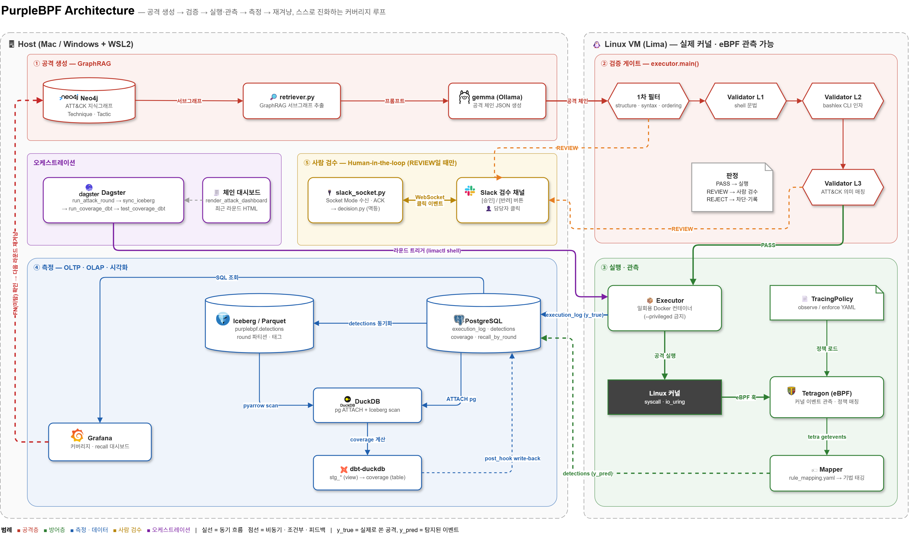

# PurpleBPF 아키텍처

- 원본: [`purplebpf-architecture.drawio`](./purplebpf-architecture.drawio) — [app.diagrams.net](https://app.diagrams.net)에서 열기 (File → Open from → Device)
- 색: 빨강=공격층 · 초록=방어층 · 파랑=측정/데이터 · 노랑=사람 검수 · 회색 점선=미구현

## 구성 요약

| 위치 | 구성 요소 | 역할 |
|---|---|---|
| Host | Neo4j · retriever · gemma(Ollama) | ATT&CK 지식그래프 기반 공격 체인 생성 (GraphRAG) |
| Host | Slack · `slack_socket.py` | REVIEW 판정 체인의 2차 사람 검수 (Socket Mode) |
| Host | Dagster | `run_attack_round → sync_iceberg → run_coverage_dbt → test_coverage_dbt` |
| Host | PostgreSQL · Iceberg · DuckDB · dbt · Grafana | 실행/탐지 저장 → 커버리지 계산 → 대시보드 |
| Linux VM | 1차 필터 · Validator L1–L3 · Executor | 체인 검증 후 일회용 Docker 컨테이너에서 실행 |
| Linux VM | Tetragon(eBPF) · Mapper | syscall/io_uring 이벤트 탐지 → 기법 태깅 → `detections` 기록 |

## 루프
1. Dagster가 VM의 Executor를 트리거 → 공격 실행, `execution_log` 기록 (y_true)
2. Tetragon이 탐지 → Mapper가 `detections` 기록 (y_pred)
3. `detections`를 Iceberg로 동기화 → dbt가 DuckDB에서 조인해 `coverage` 계산 → PG로 write-back
4. Grafana에서 FN(미탐) 확인 → 다음 라운드 공격 생성 목표로 재겨냥

데이터 구조 상세는 [`../data-model`](../data-model/README.md) 참고.

<!-- 아이콘 보강 후 PNG로 export해서 architecture.png로 넣고 아래 주석 해제 -->
<!--  -->
