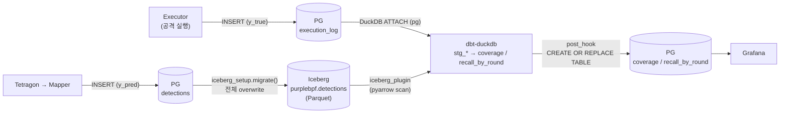
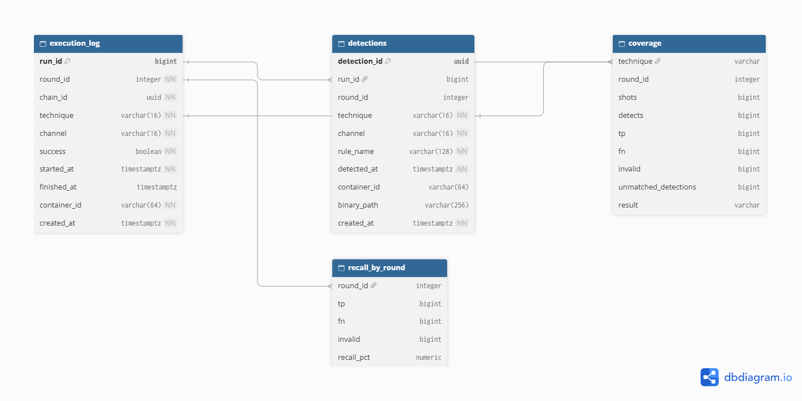
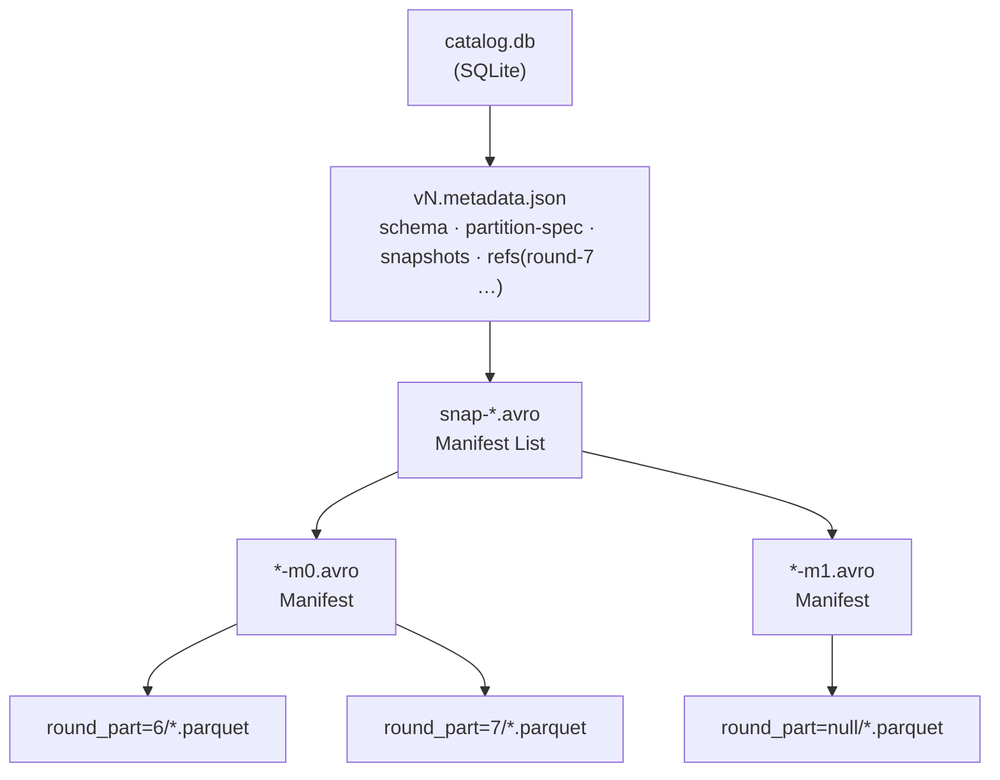
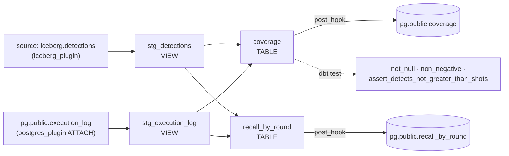

# PurpleBPF 데이터 모델 (ERD · Iceberg · dbt)

> 코드 레포: [purpleBPF/purplebpf](https://github.com/purpleBPF/purplebpf) — 아래 경로는 모두 그 레포 기준이다.

> 기준: `purplebpf` 레포 `feature/iceberg-round-snapshots` 브랜치 (커밋 `7de9d4c`, 2026-11-23).
> 근거 파일: `db/migrations/versions/*.py`, `db/views.sql`, `src/purplebpf/analysis/iceberg_setup.py`,
> `dbt/models/**`, `src/purplebpf/offensive/executor/executor.py`, `src/purplebpf/defensive/mapper/mapper.py`.

## 0. 한눈에 보기 — 데이터가 흐르는 길



| 저장소 | 역할 | 들어있는 것 |
|---|---|---|
| PostgreSQL (OLTP) | 실행·탐지 원본을 실시간으로 INSERT | `execution_log`, `detections`, dbt가 다시 써넣는 `coverage`·`recall_by_round` |
| Iceberg / Parquet (OLAP) | 탐지 이벤트를 라운드 단위 스냅샷으로 보관 | `purplebpf.detections`만 (execution_log는 옮기지 않음) |
| DuckDB (`dbt/duckdb/purplebpf.duckdb`) | PG와 Iceberg를 한 쿼리로 조인하는 계산 엔진 | dbt staging 뷰, marts 테이블 |
| Neo4j | ATT&CK 지식그래프 (공격 생성용) | `Technique`, `Tactic` 노드. 이 문서 범위 밖 |

---

## 1. PostgreSQL 테이블 ERD



- 인터랙티브 다이어그램: [dbdiagram.io](https://dbdiagram.io/d/ERD%EB%8B%A4%EC%9D%B4%EC%96%B4%EA%B7%B8-6a6ae13f067336e1de25e3dc)
- 원본(DBML): [`erd.dbml`](./erd.dbml) — dbdiagram.io에 붙여넣으면 같은 그림이 나온다.
- 관계선은 전부 **논리적 연결**이다(물리 FK 없음). 1 쪽: `execution_log.run_id`, `coverage.technique`, `recall_by_round.round_id`

### 1-1. `execution_log` — "무엇을 쐈나" (정답, y_true)
- **누가 쓰나**: `executor.py`가 공격 체인을 실행할 때마다 1행씩 쓴다. REVIEW/REJECT로 막힌 시도도 `success=false`로 기록한다.
  안 그러면 `MAX(round_id)+1`로 정하는 다음 라운드 번호가 겹친다.
- `run_id`는 실행 1회, `round_id`는 Dagster 파이프라인 1회, `chain_id`는 생성된 공격 체인 1개를 뜻한다.
- 인덱스: `round_id`, `(run_id, technique, channel)`, `started_at`, `(container_id, started_at)`. 마지막 인덱스는 컨테이너+시간창 조인용이다.

### 1-2. `detections` — "무엇을 잡았나" (예측, y_pred)
- **누가 쓰나**: `mapper.py`가 Tetragon 이벤트를 `rule_mapping.yaml`로 기법에 매핑해서 INSERT한다.
- **FK를 일부러 안 건다**: FP(오탐)는 대응되는 실행이 없으니 `run_id`가 NULL이어야 한다. 물리적 FK를 걸면 오탐을 저장할 수 없다.
- 실행과 탐지를 묶는 건 `run_id`가 아니라 **조인 조건 3개**다(§3-2).

> ⚠️ **현재 코드 상태 메모**: Mapper는 `run_id`, `round_id`를 **항상 NULL로** 넣는다(`mapper.py` `INSERT_SQL`).
> 그래서 Iceberg의 `round_id` 파티션과 `round-<id>` 태그(§2-3)가 지금 데이터에서는 전부 `round_id=NULL` 파티션에 들어간다.
> `sync_round(n)`은 0행을 읽는다. 라운드 스냅샷을 실제로 쓰려면 Mapper가 round_id를 채우거나, 동기화할 때 execution_log와 조인해서 붙여야 한다.

### 1-3. `coverage`, `recall_by_round` — dbt 결과물 (Grafana가 읽음)
- dbt가 DuckDB에서 계산한 뒤 `post_hook`으로 PG의 `public.coverage`, `public.recall_by_round`에 **테이블로 다시 써넣는다**.
- 컬럼 정의는 `dbt/models/marts/coverage.sql`, `recall_by_round.sql`의 SELECT 절과 같다.

> ⚠️ **이름 충돌 주의**: `db/views.sql`도 PG 안에 같은 이름의 **뷰** `coverage`, `recall_by_round`(+`coverage_by_round`)를 만든다.
> 데모 경로용이고 detections를 PG에서 바로 읽는다. 두 경로 중 **하나만** 써야 한다. 뷰가 있는 상태에서 dbt post_hook의
> `CREATE OR REPLACE TABLE`이 돌면 충돌한다. 또 뷰 쪽 `coverage`에는 `tp/fn/invalid/unmatched_detections` 컬럼이 없어서 대시보드 쿼리가 달라진다.

---

## 2. Iceberg에 저장되는 데이터 파일 구조 (Parquet)

### 2-1. 구성
- **카탈로그**: SQLite (`data/iceberg/catalog.db`). 서버 없이 로컬에서 돌리는 프로토타입 구성이다.
- **웨어하우스**: 로컬 파일시스템 (`data/iceberg/warehouse/`)
- **테이블**: `purplebpf.detections` (format-version 2)
- **옮기는 대상**: PG `detections`만 옮긴다. `execution_log`는 PG에 그대로 두고 DuckDB에서 ATTACH로 읽는다.

### 2-2. 디렉토리 / 파일 계층

```
data/iceberg/
├── catalog.db                              ← SQLite 카탈로그: "detections의 현재 메타데이터 파일은 어디?"
└── warehouse/purplebpf/detections/
    ├── metadata/
    │   ├── 00000-<uuid>.metadata.json      ← 테이블 메타데이터 v0 (스키마, 파티션 스펙, 스냅샷 목록, refs/태그)
    │   ├── 00001-<uuid>.metadata.json      ← 커밋할 때마다 새 버전이 생긴다 (이전 버전은 그대로 남음)
    │   ├── snap-<snapshot_id>-….avro       ← Manifest List: 이 스냅샷에 포함된 manifest 목록
    │   └── <uuid>-m0.avro                  ← Manifest: 데이터 파일 목록 + 파일별 파티션 값·행 수·컬럼 min/max
    └── data/
        ├── round_part=7/00000-….parquet    ← 실제 행 (round_id 파티션별 디렉토리)
        └── round_part=__HIVE_DEFAULT_PARTITION__ / null  ← round_id가 NULL인 행
```

읽는 순서는 이렇다. **catalog.db → 최신 metadata.json → (스냅샷 또는 태그 선택) → manifest list → manifest → parquet**.
manifest에 파일별 통계가 있어서, 조건에 안 맞는 parquet 파일은 열지 않고 건너뛴다(파일 프루닝).



> 레포에 커밋된 `metadata/`는 8월에 만든 초기본이다. 파티션 스펙이 비어 있고(`spec-id 0, fields: []`) 데이터 파일은 `.gitignore` 대상이다.
> 다음에 `get_or_create_table()`이 실행되면 `_ensure_partitioned()`가 identity 파티션 `round_part`를 추가한다.

### 2-3. 스키마 (PG → Arrow → Iceberg)

| # | 컬럼 | PostgreSQL | pyarrow (`ICEBERG_SCHEMA`) | Iceberg | required |
|---|---|---|---|---|---|
| 1 | detection_id | UUID | string | string | ✅ |
| 2 | run_id | BIGINT | int64 | long | |
| 3 | round_id | INTEGER | int32 | int | |
| 4 | technique | VARCHAR(16) | string | string | ✅ |
| 5 | channel | VARCHAR(16) | string | string | ✅ |
| 6 | rule_name | VARCHAR(128) | string | string | ✅ |
| 7 | detected_at | TIMESTAMPTZ | timestamp(us) | timestamp (**tz 없음**) | ✅ |
| 8 | container_id | VARCHAR(64) | string | string | |
| 9 | binary_path | VARCHAR(256) | string | string | |
| 10 | created_at | TIMESTAMPTZ | timestamp(us) | timestamp (**tz 없음**) | ✅ |

- **UUID → string**: Iceberg에도 uuid 타입이 있지만 pyarrow·DuckDB 호환 때문에 문자열로 저장한다.
- **TIMESTAMPTZ → tz 없는 timestamp**: `_to_naive_utc()`가 UTC로 바꾼 뒤 타임존 정보를 뗀다. 내용물은 UTC다.
  그래서 dbt에서는 반드시 `d.detected_at AT TIME ZONE 'UTC'`로 감싸서 비교한다. 안 감싸면 KST 환경에서 9시간이 어긋나 `detects=0`이 된다(실측).
- **파티션**: `round_id`에 identity 변환을 적용하고 필드 이름은 `round_part`다. 소스 컬럼과 이름이 같으면 pyiceberg가 거부해서 이름을 바꿨다.

### 2-4. 쓰기 방식 / 스냅샷 / 태그

| 함수 | 동작 | 멱등성 |
|---|---|---|
| `migrate()` | PG detections 전체로 **overwrite**하고, 존재하는 모든 라운드에 태그를 단다 | 다시 실행해도 중복 없음 |
| `sync_round(n)` | `round_id = n` 파티션만 overwrite하고 `round-n` 태그를 단다 | 같은 라운드를 다시 써도 중복 없음 |
| `expire_round_snapshots()` | 태그 없는 스냅샷 중 최신 5개만 남기고 정리한다. 기본은 `dry_run=True` | 태그 달린 라운드 스냅샷은 항상 보존 |

- Dagster `sync_iceberg` asset은 지금 `migrate()`(전체 overwrite)를 호출한다.
- 태그 `round-<id>`는 그 라운드를 기록한 시점의 스냅샷을 가리킨다. dbt 소스에 `meta.round_id: 7`을 주면 `iceberg_plugin`이 그 시점으로 타임트래블해서 읽는다.

### 2-5. Parquet 파일 하나의 내부

```
xxxx.parquet
├── Row Group 0               ← 행 묶음 (기본 수십~수백 MB 단위)
│   ├── Column Chunk: detection_id   (페이지 단위 인코딩·압축)
│   ├── Column Chunk: technique      (dictionary 인코딩 — 값 종류가 적음)
│   ├── Column Chunk: detected_at    (int64 마이크로초)
│   └── …
└── Footer: 스키마 + Row Group별 컬럼 통계(min/max/null_count)
```

컬럼 단위로 저장하기 때문에 coverage 조인처럼 `technique, container_id, detected_at` 몇 개 컬럼만 읽는 분석에 유리하다.
`technique`·`channel`처럼 값 종류가 적은 컬럼은 dictionary 인코딩 덕분에 크게 압축된다.

**왜 detections만 Iceberg로 옮기나**: 탐지 이벤트는 양이 많고 계속 쌓이며(append 위주), 라운드별로 "그 시점 상태"를 다시 봐야 한다(타임트래블).
execution_log는 라운드당 수 행이고 Executor가 실시간으로 쓰는 트랜잭션 데이터라서 PG에 두는 편이 맞다.

---

## 3. dbt — `coverage.sql`과 "왜 테이블로 저장하나"

### 3-1. 모델 계보



`dbt_project.yml` 설정: `staging: +materialized: view`, `marts: +materialized: table`

### 3-2. `coverage.sql`이 하는 일

1. **shots**: execution_log의 실행 1회(run_id)마다 매칭되는 탐지 개수(hits)를 센다. 조인 조건은 아래 4개다.
   - `technique` 일치
   - `d.container_id LIKE e.container_id || '%'`: Docker short id는 12자, Tetragon id는 31자라서 접두사로 비교한다.
   - **시간창**: `started_at ≤ detected_at ≤ finished_at + eps초`(기본 2초, `var('coverage_eps_seconds')`). 뒤쪽 여유는 이벤트 파이프라인 지연을 흡수하기 위한 것이다.
   - LEFT JOIN이라 hits=0인 실행도 남는다. 이게 FN이 된다.
2. **unmatched**: 어떤 *성공한* 실행과도 묶이지 않는 탐지를 기법별로 센다. 오탐 후보지만, 배경 활동이 섞여 있어서 베이스라인을 재기 전에는 오탐률로 쓰지 않는다.
3. **최종 집계**(technique별 1행): `shots / tp / fn / invalid / unmatched_detections / result`
   - `success=false`는 FN이 아니라 **INVALID**로 분리한다. 가짜 미탐이 다음 라운드 생성 목표로 들어가는 걸 막기 위해서다.
   - `detects`는 탐지된 *공격 수*라서 정의상 `tp`와 같다.

> technique 하나로만 조인하면 안 되는 이유(실측): T1611이 TP로 나왔는데, 그 672건은 전부 runc가 컨테이너를 만들면서 부른 setns/unshare였다. 실제 공격은 seccomp에 막혀 실행조차 안 됐다.

### 3-3. 왜 `materialized='table'`로 저장하게 했나

| 이유 | 설명 |
|---|---|
| **① PG로 복제(write-back)해야 Grafana가 읽는다** | Grafana의 데이터소스는 Postgres다(`infra/grafana/provisioning/datasources/postgres.yml`). DuckDB 안의 뷰는 Grafana가 볼 수 없다. 그래서 `post_hook`이 `CREATE OR REPLACE TABLE pg.public.coverage AS SELECT * FROM {{ this }}`로 결과를 PG에 실제 테이블로 내려보낸다. 복사할 원본도 그 자리에 고정된 결과여야 깔끔하다. |
| **② 입력이 dbt 실행 중에만 연결된다** | `coverage`의 입력은 Iceberg(pyarrow로 읽어 등록)와 Postgres(ATTACH)다. 둘 다 dbt 플러그인이 연결을 열 때 붙는다. 뷰로 두면 조회할 때마다 이 연결이 다시 필요하다. 테이블로 두면 계산 결과가 DuckDB 파일에 남는다. |
| **③ `dbt test`는 별도 프로세스다** | `profiles.yml` 주석대로 `dbt run`과 `dbt test`는 다른 프로세스라서 DuckDB를 파일로 쓴다. 테스트(`detects ≤ shots`, `non_negative` 등)는 run이 만든 **같은 결과물**을 검사해야 한다. 뷰면 test 시점에 다시 계산되니 run이 낸 결과를 검사한다는 보장이 없다. |
| **④ 무거운 조인을 라운드당 1번만** | `LIKE` 접두사 + 시간창 범위 조건은 등호 조인이 아니라서(non-equi join) 비싸다. 라운드가 끝날 때 한 번 계산해 두고 대시보드는 그 결과만 읽는다. |
| **⑤ 라운드 결과를 고정된 값으로 남긴다** | Dagster가 `run_attack_round → sync_iceberg → run_coverage_dbt` 순서로 돌면, 그 라운드의 판정이 그 시점 값으로 고정된다. 반면 `db/views.sql`의 PG 뷰는 조회할 때마다 다시 계산하는 "항상 최신" 경로다. 두 경로의 목적이 다르다. |

> ①·③은 코드 주석(`coverage.sql` config, `profiles.yml`)에 근거가 있다. ②·④·⑤는 구조를 보고 정리한 설명이라 팀원 확인이 필요하다.
> `staging`은 뷰로 둔다. 원본을 거의 그대로 노출하는 얇은 계층이고 marts에서 한 번만 읽기 때문이다.

### 3-4. 데이터 테스트
- `coverage.yml`: `technique not_null`, `shots/detects not_null + non_negative`(커스텀 매크로 `test_non_negative`)
- `tests/assert_detects_not_greater_than_shots.sql`: `detects > shots`면 조인 버그로 본다. `shots = 0`인 행(UNMATCHED)은 예외다.
- Dagster `test_coverage_dbt`는 테스트가 실패해도 경고만 남기고 파이프라인은 완료로 처리한다.
